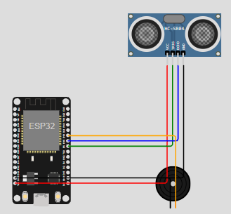

# 🎶 Projeto_M.M. — Controle de Música por Gestos

**Projeto final da Owlficina de Microcontroladores** · **ESP32** · **MicroPython** · **Wokwi**

🎮 **[Abrir e executar nosso projeto no Wokwi](https://wokwi.com/projects/479323831221297153)**

O **Projeto_M.M.** é uma experiência interativa em que a distância de uma mão (representada por um objeto virtual na simulação) controla a **velocidade de uma melodia**. Quanto mais perto do sensor ultrassônico, mais rapidamente as notas são tocadas; quanto mais longe, mais lentamente elas são tocadas.

> Esta imagem mostra a montagem produzida pelo grupo no Wokwi. O projeto foi desenvolvido e testado virtualmente, sem montagem física.

## 👥 Integrantes

- **Bianca Vieira da Silva**
- **Marina Piccolo Gritti Rahman**
- **Samuel Riki Alruiz Nunez**

## 1. Descrição do projeto

A proposta é criar um instrumento musical simples que não exige contato físico para alterar o ritmo. Um **ESP32** executa o código em **MicroPython**, um **HC-SR04** mede a distância da mão e um **buzzer passivo** reproduz uma sequência de notas.

**Funcionalidades principais**

- Medição contínua da distância no sensor ultrassônico.
- Aceleração da melodia quando a mão se aproxima.
- Desaceleração da melodia quando a mão se afasta.
- Exibição da distância e do multiplicador de velocidade no terminal do Wokwi.
- Retorno à velocidade normal quando não há uma leitura válida.

A melodia é definida diretamente no programa: **o projeto não reproduz arquivos MP3**. A velocidade muda porque a duração de cada nota muda, enquanto sua frequência permanece a mesma.

## 2. Lista de componentes

| Quantidade | Componente | Função |
|:---:|---|---|
| 1 | **ESP32 DevKit V1** | Executa o código e controla o sensor e o buzzer |
| 1 | **Sensor HC-SR04** | Mede a distância por ultrassom |
| 1 | **Buzzer passivo** | Produz as notas musicais por PWM |
| 6 | **Fios virtuais** | Fazem as ligações entre os componentes |

**Ferramentas:** [Wokwi](https://wokwi.com/) para simulação e MicroPython para programação.

## 3. Conexões — mapeamento dos pinos

As ligações utilizadas no arquivo `diagram.json` são:

| Componente | Terminal | ESP32 | Função |
|---|---|---|---|
| HC-SR04 | VCC | VIN (5 V) | Alimentação do sensor |
| HC-SR04 | GND | GND | Terra comum |
| HC-SR04 | TRIG | GPIO 5 (D5) | Disparo do pulso ultrassônico |
| HC-SR04 | ECHO | GPIO 18 (D18) | Leitura do tempo de retorno |
| Buzzer | 2 (+) | GPIO 19 (D19) | Sinal PWM das notas |
| Buzzer | 1 (−) | GND | Terra do buzzer |

**Nota sobre hardware real:** a saída ECHO do HC-SR04 alimentado a 5 V precisa de adaptação de nível lógico antes de ser ligada ao ESP32 (3,3 V). A ligação acima descreve a **simulação no Wokwi**.

## 4. Esquema do circuito

O circuito original do grupo pode ser visto na imagem acima e está descrito integralmente em [`diagram.json`](diagram.json).

**Simulação original do grupo:** [Projeto_M.M. no Wokwi](https://wokwi.com/projects/479323831221297153). O projeto já está montado com o ESP32, o HC-SR04 e o buzzer. Basta abrir o link e iniciar a simulação.

## 5. Funcionamento lógico e técnico

### 5.1. Leitura da distância

1. O ESP32 envia um pulso de aproximadamente **10 μs** ao pino `TRIG`.
2. O sensor HC-SR04 retorna um pulso no pino `ECHO`.
3. A função `time_pulse_us()` mede a duração do retorno.
4. A distância aproximada, em centímetros, é calculada por:

   `distância (cm) = duração do pulso (μs) / 58`

Se a medição falhar, o programa considera a velocidade normal (`1,0x`).

### 5.2. Cálculo da velocidade

A distância fica limitada à faixa de **5 a 40 cm**. A partir dela, o programa calcula um multiplicador de velocidade entre **2,0x e 0,5x**, de maneira linear.

| Distância | Velocidade aproximada | Resultado |
|:---:|:---:|---|
| 5 cm | **2,0x** | Melodia mais rápida |
| 20 cm | **1,36x** | Velocidade intermediária |
| 40 cm | **0,5x** | Melodia mais lenta |

A duração de cada nota segue:

`duração ajustada = duração original / multiplicador de velocidade`

Assim, notas com menor duração produzem um ritmo mais rápido.

### 5.3. Reprodução do som

A lista `melodia` armazena pares de **frequência (Hz)** e **duração (s)**. Para cada nota, o ESP32 mede a distância, calcula a velocidade e utiliza **PWM** para controlar o buzzer. Ele toca a nota por 85% de sua duração ajustada e deixa uma breve separação de 15%. A sequência recomeça continuamente.

### 5.4. Testes realizados

O grupo executou a simulação no Wokwi e confirmou que o buzzer toca, que as leituras aparecem no terminal e que a velocidade da melodia muda ao alterar a distância do HC-SR04. A imagem nesta documentação foi capturada do circuito utilizado no teste.

## ▶️ Como executar

1. Abra o [Projeto_M.M. no Wokwi](https://wokwi.com/projects/479323831221297153).
2. Clique em **▶** para iniciar a simulação.
3. Clique no **HC-SR04** e altere a distância.
4. Ouça a melodia e acompanhe a distância e a velocidade no terminal.

---

*Projeto_M.M. — Owlficina de Microcontroladores.*
